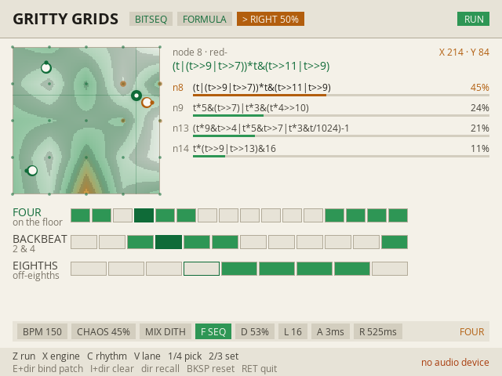
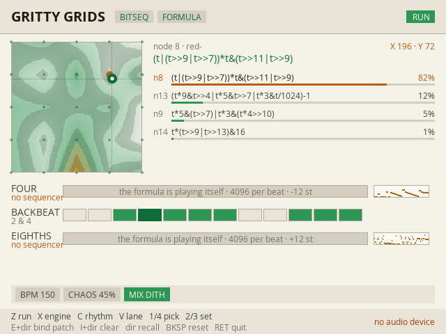

# Gritty Grids for sndstation

A native port of the [Gritty Grids](../demos/gritty-grids.html) bytebeat drum machine to
[sndstation](https://github.com/sndstation/sndstation), the app platform for RK3326 /
RK3566 / H700 Linux handhelds (Anbernic RG351V and RG40XX, R36S, Powkiddy RGB30, RG
CubeXX and relatives). It builds and runs on a desktop too — macOS or Linux — which is
where it was developed and measured.

> **Status: builds clean, tested headless and on a desktop; not yet run on a handheld.**
> The bytebeat engine is verified bit-exact against the web demo (809,325 samples, see
> *The nodes are bit-exact* below). The audio path, the screens and the clean exit are
> exercised here. What is untested is the thing only hardware can test: how it feels
> under a thumb on a real stick, and how the audio thread behaves on an RK3326.

Unlike the [Max/MSP port](../max/README.md), which is the 4-corner oscillator alone,
this is the whole demo: the 25-node map, both engines, the polyrhythm, per-voice A/R/P,
ratchets, and Chaos.



*Bitseq, Formula rhythm: the puck sits between four programs, the readout names them and
their weights, and the three tracks are running at 16 / 12 / 9. The three rings on the map
are patches bound to D-pad directions — the amber one is being morphed to, half way
there, with BPM, Chaos and the lane controls all part way between the two.
([Bit voice](docs/voice-formula.png) adds a 1-bit trace per lane;
[`--dark`](docs/bitseq-formula-dark.png) is the demo's phosphor.)*

## What it is

[Mutable Instruments Grids](https://github.com/sonic-insurgence/Gritty-Grids) stores 25
drum patterns in a 5x5 map and bilinearly interpolates between the four nearest as you
move an X/Y position. Gritty Grids replaces those 25 patterns with 25 real bytebeat
one-liners from viznut's *Collection of oneliner music formulas* (2011), each attributed
on screen as you move over it. Everything downstream is derived from the blend:

- **Rhythm source** — *Roles* gates a Four / Backbeat / Eighths skeleton with the
  blended curve; *Formula* thresholds the curve itself, so the pattern comes from the
  program and morphs as you drag.
- **Polyrhythm** — in Formula each of the three tracks has its own length (16 / 12 / 9
  by default), so the slices phase against each other over 144 pulses.
- **Two engines** — *Bitseq* renders each hit as a short grain of the interpolated
  formula's waveshape, played at the lane's own pitch, so the drum timbre morphs with
  the map. *Bit voice* makes each lane a sustained 1-bit bytebeat oscillator — Grids'
  three trigger outs repurposed as three voices.
- **Per-voice A / R**, **P** (trigger probability, which ratchets into exponential rolls
  past three quarters), and a **Chaos** knob that mutates pattern, timing and per-hit
  timbre at once.
- **Free lanes** — a lane can switch its sequencer off entirely and let the formula play
  its own music, clocked to the tempo and transposed by semitones. See
  *[A lane with no sequencer](#a-lane-with-no-sequencer)* below.

Nothing is sampled. Every sound on screen is arithmetic on a counter.

## Controls

The puck is the instrument; everything else is a modifier.

| | |
|---|---|
| **Left stick** | move the puck — this is the whole gesture |
| **D-pad** | move the puck, slower — until a patch is bound to that direction |
| **L3 + a direction** | bind the whole patch to that D-pad direction |
| **R3 + a direction** | unbind it |
| **A** | Run / Stop (a run always starts at pulse 0) |
| **B** | engine: Bitseq / Bit voice |
| **X** | rhythm source: Roles / Formula |
| **Y** | jump to the next lane's controls |
| **F** (per lane) | sequencer off: the formula plays itself |
| **K** (per lane) | transpose a free lane, in semitones |
| **MIX** | how the four corners blend: `DITH`, `NEAR`, `MEAN` |
| **LIB** | which page of an imported library the map is made of |
| **L1 / R1** | pick a control |
| **L2 / R2** | change it — hold to repeat, and it coarsens the longer you hold |
| **SELECT** | back to the defaults, and clear the destinations |
| **START** | quit (back to the launcher on a handheld) |

### The blend

The map is 25 programs and the puck is almost never standing on one, so
something has to decide what you hear in between. The first answer here was a
weighted average of the four nearest nodes' bytes. That is wrong in a way that
matters.

A bytebeat byte is a **bit pattern**, not a sample on a continuum. The music is
in the `&`, the `|`, the `^` and the carries of a multiply. Average four
unrelated programs and you land between every pattern and on none of them; the
arithmetic character — the thing that makes a one-liner sound like anything at
all — is the first thing to go. Four distinct drum programs average to a wash.

So `MIX DITH`, the default, does not invent a byte. It **chooses** one, per
tick, from a real program, each corner winning ticks in proportion to its
bilinear weight. Over a beat you hear the mixture; over any single tick you
hear one authentic byte. This is how Grids itself blends — by probability, not
by averaging — and it is what a bytebeat remix does by hand.

The choice is made with the van der Corput sequence, the bit-reversal of the
tick index, rather than a random number. Equidistribution is the entire point:
white noise clumps, and a clump is an audible stutter of one program where the
weights promised a mixture. Being a pure function of `t`, it is also
deterministic — the same map position sounds the same every time, which is why
it can be tested at all.

Two details worth knowing. A corner under 2% is dropped rather than handed rare
ticks, because one byte in fifty from a program you are nowhere near reads as a
click, not as a blend. And above 92% a node plays alone, so every node sits in a
plateau where the formula is exactly itself.

`NEAR` plays the dominant corner only, with a hard switch at the cell
boundaries. `MEAN` is the old average, kept because the difference is the point
and ought to stay audible.

### Destinations

A destination is a **whole patch, not a place**: the puck's position *and* every
parameter — BPM, Chaos, both engine switches, and all five controls on each of the three
lanes. Hold **L3** and press a direction to bind the current state to it; **R3** and a
direction unbinds. Press a bound direction and the instrument travels there. **SELECT**
clears all four along with the rest of the reset; nothing is written to disk.

Travel is a glide, not a jump, and it glides *everything*. A recall is a morph between
two patches, and the sweep through the middle is itself worth hearing — cutting straight
to the destination throws that away. A long hop takes longer than a short one, between
0.18 and 0.9 seconds, eased at both ends. The engine and rhythm-source switches cannot be
interpolated, so they snap at the start and the destination's engine carries the morph.

The stick interrupts a glide at any point, which leaves every value halfway between the
two patches. That is the point rather than a wrinkle: half of a morph is a patch you did
not have, and you can bind *that* to another direction.

Bound patches show on the map as rings at their stored position, with a pip on the side
they answer to, amber for the one being travelled to; the HUD shows how far along the
morph is. The pip is drawn geometry rather than an `↑`, because Open Sans has no arrow
glyphs at this size — worth knowing before anyone simplifies it back to a character.

### A lane with no sequencer



*FOUR and EIGHTHS are free, an octave apart; BACKBEAT is still sequenced. The traces on
the right are the formulas' actual waveforms, not 1-bit squares.*

These one-liners are not oscillators — they are **music**, with their own drums, basslines
and phrasing, which is why viznut's collection is worth listening to rather than merely
hearing. Everything else in this app treats them as raw material: Bitseq chops a formula
into 256-sample wavetables and rebuilds it as a drum, Bit voice takes one bit of it and
gates the square with an envelope. Both are the sequencer talking over the tune.

Set a lane's **F** control to FREE and it stops: no gate, no envelope, no grain, no
probability, no ratchet. That lane's output is the formula itself.

**Nothing is done to the signal on the way out.** No low-pass, no DC blocker, no clip, no
grit, no dither — the byte leaves `bytebeat.h` and arrives at the device. The only thing
in the path is the zero-order hold that carries 8000 Hz up to the device rate, which is
what a bytebeat has always been played through and is where its aliasing character comes
from; interpolating there would smooth the sound off rather than preserve it. A sample at
full scale is a byte of 255, not a limiter engaging, because there is no limiter.
`test_free` renders real audio through the real engine and compares it with the formulas
computed directly, sample for sample — add a filter to that path and the test fails.

#### Quantised tempo and key

A free lane's pitch and its tempo are the same number, because a bytebeat has no pitch
apart from how fast `t` advances. Quantising means picking a rate at which a
**power-of-two block of `t` lands exactly on a beat** — that is the grid these programs
are written to, their bars being 2^12 or 2^13 samples long, which is why they sound like
music at 8000 Hz and like noise at 8001. The rate chosen is the power of two closest to
the native 8000: at 120 BPM that is 8192, so **4096 samples a beat**, and the formula's
own bar lines up with the sequencer's.

**K** transposes in semitones, which multiplies that rate — so only whole octaves stay on
the grid. A semitone is 2^(1/12), an irrational ratio, so the formula's bar drifts against
the beat on purpose. Nothing can separate the two without resynthesising the signal, which
would be the end of the sound design, so the app does not pretend otherwise: a key that is
not a whole octave reads `*` on the strip and *off the grid* on the lane.

The one liberty taken is the blend. Between nodes a free lane plays a weighted average of
four programs' bytes, which is a signal none of them is. Standing on a node, the weights
are 1 and 0 and you are hearing that one-liner exactly.

### Reaching the rest of the controls

Only BPM, Chaos and the focused lane's live controls are on the strip at once. **L1 / R1** walk the
whole list, crossing into the next lane when they run out; **Y** jumps straight to the
next lane. A control the current mode has no use for is skipped rather than shown dead:
**L** (track length) only exists in Formula, **P** only in Bit voice, and **K** only on a
free lane. **D** is density in Bitseq and pitch in Bit voice, and reads out in the right
units for each. A free lane has no sequencer and no envelope, so D, L, A, R and P are not
dimmed there — they are gone, and only **F** and **K** remain.

On a desktop the keyboard is a full pad (sndstation's own fallback): arrows for the
D-pad, **Z** and **X** for A and B, **C** and **V** for X and Y, **1**/**4** for L1/R1,
**2**/**3** for L2/R2, **E** and **I** for L3/R3, **Backspace** reset, **Return** quit.
With no pad attached the footer names those keys rather than the pad's buttons — it used
to say "L1/R1 pick" to someone holding a keyboard, which is the one moment the hint
mattered.

## Playing a library

The map ships as 25 one-liners from viznut's 2011 collection, hand-ported into
C++ in `bytebeat.h` and bit-exact. That is the right way to carry 25 formulas
and the wrong way to carry two thousand, so there is a second evaluator:
`expr.h` reads the JavaScript these programs are actually written in and plays
it directly. Point the app at a library pack and the map is made of that
instead — same blend, same destinations, same free lanes, somebody else's
music.

```bash
./build/gritty-grids --library library.pack
```

`LIB` on the control strip pages through it, 25 songs at a time. Whoever wrote
the program under the puck has their name on the screen, built-in or imported.

### Making a pack

```bash
tools/import-library.py ~/Downloads/all.gz -o library.pack
```

The input is the song index published by
[bytebeat-composer](https://github.com/SthephanShinkufag/bytebeat-composer),
served at `data/library/all.gz`.

**Download your own copy; nothing from it is committed here, and `library.pack`
is gitignored.** The composer's own source is MIT, but the library is not the
composer: it is about two thousand separate compositions by a couple of hundred
named people, each published by its author with their name attached, and it
does not live in that repository at all. They are theirs to distribute, not
ours to vendor. So the port carries the machinery and you bring the music —
which also means a re-download gets you everything added since.

### What a pack keeps, and what it drops

Every song is rendered twice — once by `expr.h` and once by **node**, the
engine these programs were written for — and kept only where the two agree
exactly. A song this port would play even slightly differently is dropped. A
near-miss is not a near-miss; it is somebody's music played wrong.

The reference run uses the composer's own preamble, copied from its audio
processor: every `Math` name in scope as a bare name, `int` as `Math.trunc`,
`window` as the global. A song written `sin(t)` depends on that, so a reference
run without it would be testing the wrong language.

From the archive as it stood on 2026-11-05, that is **536 songs by 232
authors**, out of 1112 that carry their code inline. Honestly, where the rest
go:

| | |
|---|---|
| 894 | no inline code in the index — they live as separate files on the server |
| 517 | past this evaluator's grammar |
| 76 | stereo (a two-element return); the map is mono |
| 47 | render differently from node, so dropped on principle |
| 12 | node itself will not run them |
| 6 | truncated in the index |
| 3 | Funcbeat — statements, a different language |

The grammar is expressions, not statements: the operators with JavaScript's
coercions, `Math`, constant lookup tables, strings via `[i]` and
`.charCodeAt(i)`, the ternary, and plain local variables in a frame that starts
fresh each sample. `Math.random` is refused deliberately — it would make a song
sound different on every pass, which breaks both the determinism the blend
rests on and any hope of verifying anything. A song whose variables carry state
between samples renders differently from node and is dropped by that rule
rather than by a special case.

Two things a loaded song carries that a built-in does not. Its **playback
mode** — unsigned byte, signed byte, or float, the last kept fractional rather
than rounded back down to eight bits. And its own **sample rate**: a song
written for 44100 is not a slower version of itself at 8000, it is two and a
half octaves down with its rhythm stretched, so each slot scales its own `t`
and four songs with four native rates can sit on one map and each still be
itself.

The rhythm map stays Grids. The 25 interpolated drum patterns are the
instrument's groove structure; the loaded songs are its voices. Letting a page
change rewrite the patterns under you would make the map unnavigable, and a
free lane bypasses the sequencer anyway, which is where a loaded song has the
most to say.

Interpreting costs about three and a half times what the built-ins do — 2% of
one core for three lanes against 0.6% — which is still nothing on a handheld.

## Building

You need SDL2 and a checkout of sndstation.

```bash
sudo apt install build-essential cmake pkg-config libsdl2-dev libsdl2-ttf-dev
```

```bash
git clone https://github.com/sndstation/sndstation ../../sndstation
```

```bash
cmake -S . -B build -DSNDSTATION_DIR=../../sndstation && cmake --build build -j4
```

```bash
./build/gritty-grids
```

On macOS, `brew install pkg-config sdl2 sdl2_ttf` instead of the apt line.

`SNDSTATION_DIR` is required and is checked: a wrong path fails at configure time saying
what to do about it, rather than at link time.

### Switches

| | |
|---|---|
| `--library FILE` | load a library pack and make the map out of it, 25 songs at a time |
| `--dark` | the demo's phosphor palette instead of the default paper one |
| `--res WxH` | force the layout size |
| `--shots DIR` | headless: write one BMP per screen state (both engines x both rhythm sources) and exit. No display needed. |
| `--bench SEC` | headless: render SEC seconds of audio through both engines with the puck sweeping the map, and report cost, level and clipping. No display, no device. |

`--bench` is the one to run after touching the DSP:

```bash
./build/gritty-grids --bench 20
```

```
bitseq       49.7 ms for 20.0 s audio =  0.25% of one core   peak 1.00  rms 0.090  at full scale 0.001%
bit-voice    71.3 ms for 20.0 s audio =  0.36% of one core   peak 1.00  rms 0.193  at full scale 0.194%
free x3      70.1 ms for 20.0 s audio =  0.35% of one core   peak 1.00  rms 0.403  at full scale 0.288%
```

"At full scale" is `|x| >= 0.999`. For the two sequenced engines that is the clipper
engaging. For free lanes there is no clipper: a byte of 255 is exactly +1.0, so those
samples are the formula's own range arriving intact.

(An Apple M-series desktop. An RK3326 is roughly an order of magnitude slower per core,
which still leaves both engines comfortably inside one audio thread — but that number
wants measuring on the unit, not predicting.)

## Installing on a handheld

The launcher lists an app when it finds a manifest. Copy
[`gritty-grids.json`](gritty-grids.json) to `~/.local/share/sndstation/apps/` (or ship it
in a package's `/usr/share/sndstation/apps/`) with `exec` pointing at the binary:

```bash
install -Dm755 build/gritty-grids ~/.local/bin/gritty-grids
```

```bash
install -Dm644 gritty-grids.json ~/.local/share/sndstation/apps/gritty-grids.json
```

When the launcher starts it, it hands over the display, the audio device and the
machine; quitting with START brings the launcher back.

## The nodes are bit-exact

Bytebeat is written in C's integer arithmetic but almost always *heard* through a
JavaScript engine, and the two disagree: JS coerces shift operands with ToInt32 and masks
the shift count to 5 bits, while its multiplies are doubles that only wrap when a bitwise
operator consumes them. Node 1 (`(t*(t>>5|t>>8))>>(t>>16)`) is audibly nothing but that
wrap; node 24 hinges on `0x8898a989` becoming a *negative* int32 under `>>`.

So the reference for this port is the web demo, not a textbook. `test_bytebeat` holds
golden values generated by running the demo's own `NODES` array in node, plus an FNV-1a
hash over a dense sweep — every node across `t = 0..200000` and `1M..20M`, 809,325
values:

```bash
ctest --test-dir build
```

```
test_bytebeat: 25 nodes, 809325 samples, bit-exact with the web demo
test_free: 4096 samples bit-exact with the formula, 4096 (2^12) per beat, rms 0.384
```

A change to [`bytebeat.h`](bytebeat.h) that alters one byte anywhere in that range fails
the test. The one deliberate departure is documented at the top of that file: past 2^53
JavaScript loses the low bits of a product, which only the Bit voice engine's
free-running `t` reaches, after hours of continuous play. int64 keeps them. This port is
the more correct of the two and nobody will hear the difference.

## How the port differs from the demo

Four changes, forced by the platform, by the demo being wrong, or by a handheld not
being a browser window:

1. **One clock instead of two.** WebAudio let the demo schedule Bitseq hits as buffers a
   tenth of a second ahead while Bit voice ran in a ScriptProcessor. sndstation gives an
   app one `render(float*, frames)`, so both engines run sample-accurate inside it.
   Chaos's *negative* timing jitter survives that only because hits are decided one pulse
   early and queued — see the lookahead in [`engine.h`](engine.h).
2. **A fixed grain pool.** Each Bitseq hit builds its 256-sample wavetable into one of 24
   pre-allocated slots. Nothing in the render path allocates, locks or calls a
   general-purpose RNG.
3. **The grid shows what actually fires.** In Bit voice the demo draws the *density*
   pattern while the engine gates on the role (or a fixed half-range threshold) and
   ignores density entirely — that control is pitch in Bit voice. Here the grid is drawn
   from the same rule the engine uses, so what is lit is what you hear.
4. **Paper, not phosphor, by default.** The demo is a dark CRT because it lives in a
   browser tab at night. A handheld goes outside, where a dark screen with thin bright
   green text is the worst case for a cheap panel in daylight, so the default palette is
   dark ink on paper and the accents keep the demo's hues at a value that carries on it.
   `--dark` is the demo's CSS exactly, for the times the room is dark.

The map, the blend, the thresholds, the envelopes, the probability curve, the ratchet
ladder, the kick's pitch drop and the 1-bit grit are all the demo's own numbers.

## Files

| | |
|---|---|
| [`bytebeat.h`](bytebeat.h) | the 25 nodes, with JavaScript's integer semantics spelled out |
| [`expr.h`](expr.h) | a bytebeat expression, parsed and played — the JavaScript subset |
| [`bank.h`](bank.h) | which 25 programs the map is currently made of |
| [`engine.h`](engine.h) | the map, the blend, both engines, as one render callback |
| [`main.cpp`](main.cpp) | the screen, the pad, the controls, `--shots` and `--bench` |
| [`test_bytebeat.cpp`](test_bytebeat.cpp) | the golden values and the dense-sweep hash |
| [`test_free.cpp`](test_free.cpp) | proof that nothing processes a free lane |
| [`test_blend.cpp`](test_blend.cpp) | proof that the blend never invents a byte |
| [`test_expr.cpp`](test_expr.cpp) | the evaluator against the 25 hand-ported formulas |
| [`tools/import-library.py`](tools/import-library.py) | verify a library against node, write a pack |
| [`tools/verify-expr.cpp`](tools/verify-expr.cpp) | render expressions with `expr.h`, for comparison |
| [`tools/verify-expr.mjs`](tools/verify-expr.mjs) | render the same, from a real JavaScript engine |
| [`gritty-grids.json`](gritty-grids.json) | the launcher's manifest |
